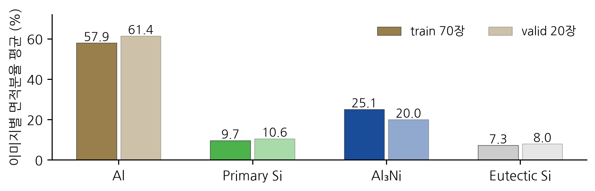
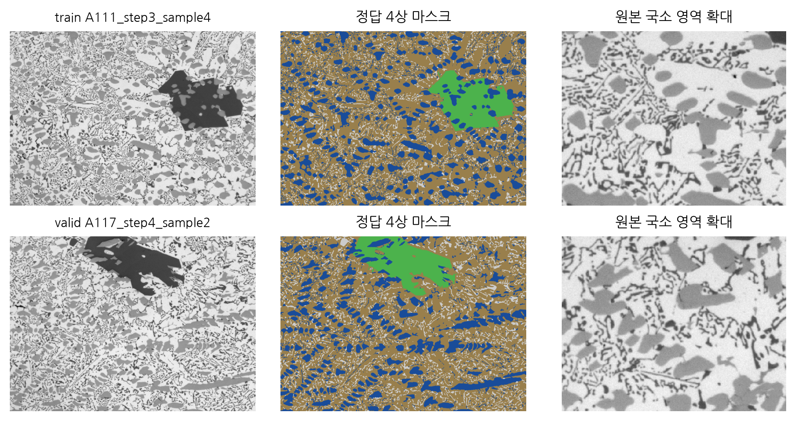
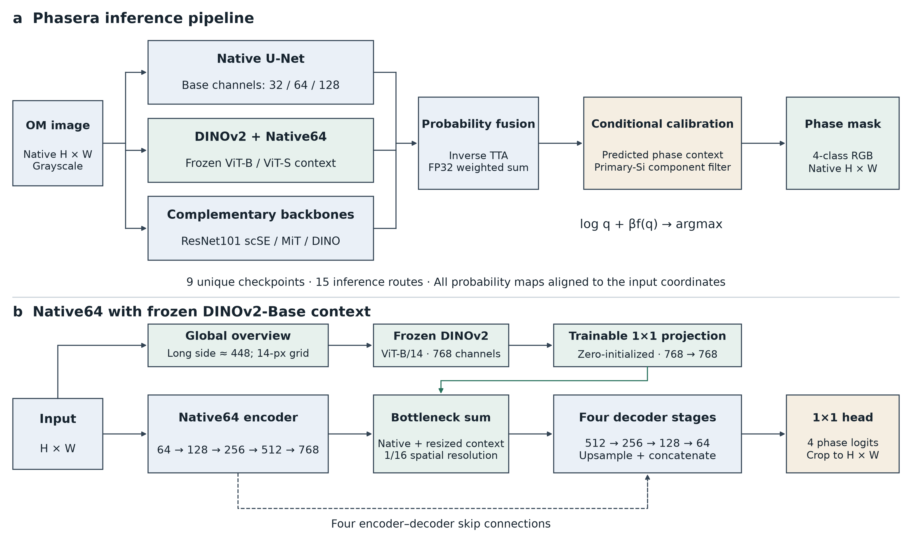
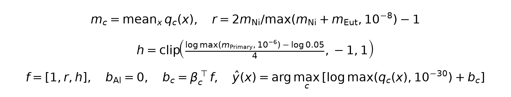
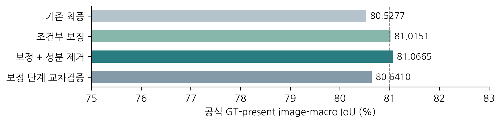
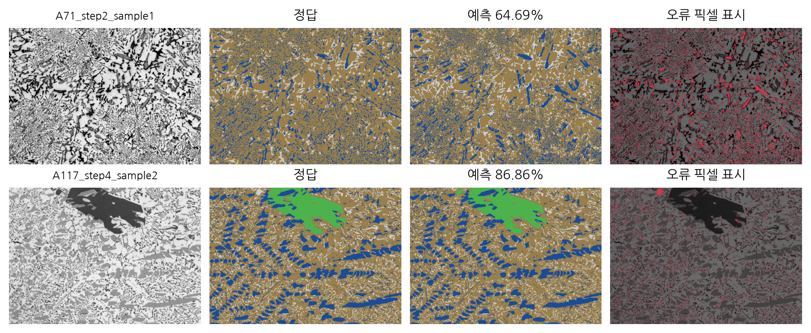

# Phasera · KoMaP AI Competition 2026

**고탄성 알루미늄 합금 현미경 영상의 4상 분할 — 원본 해상도 특징과 조직 문맥을 결합한 조성 적응형 모델**

팀 **Phasera** · 접수번호 **A901005** · 제공 validation 20장 공식 방식 IoU **81.0665%**

현미경 영상에서 Al, Primary Si, Al₃Ni, Eutectic Si를 픽셀 단위로 분할합니다. 미세 공정 Si의 경계와 큰 입자의 주변 문맥을 함께 표현하고, 영상별 예측 상 분포에 맞춰 분류 결정 경계를 조절합니다.

> 81.0665%는 제공 valid를 모델·보정 선택에 사용한 개발 검증 점수입니다. 공식 평가 **계산 방식**을 적용한 값이며, 비공개 test 성적이나 대회 순위가 아닙니다. 보정 단계 그룹 교차검증은 80.6410%이며 전체 파이프라인의 독립 nested CV와 구분합니다.

[10페이지 보고서 PDF](01_Proposal/Phasera_Modeling_Report.pdf) · [편집용 DOCX](01_Proposal/Phasera_Modeling_Report.docx) · [실행 안내](02_Analysis/README.txt) · [제출물과 가중치 다운로드](https://github.com/choi0312/Phasera-KoMaP-2026/releases/tag/v1.0.0)

## 1. EDA에서 도출한 모델링 전략

| 관찰 | 실제 통계 및 특성 | 모델 설계에 반영 |
|---|---|---|
| 미세 상의 높은 경계 비중 | 공정 Si 픽셀 중 경계 1 px 이내: train **63.16%**, valid **63.59%** | 원본 해상도 경로와 skip 연결로 가는 조직 정보를 전달 |
| 영상별 상 분포 차이 | Al₃Ni 이미지 평균 면적분율: train **25.14%**, valid **20.03%** | 예측 상 분포를 연속 문맥 변수로 사용하는 조건부 보정 |
| 초정 Si와 공정 Si의 형상 차이 | 큰 각형 입자와 얇은 망상 구조의 공존 | 전체 시야 문맥과 국소 특징의 결합, 상별로 다른 정제 규칙 |
| 상 부재와 작은 표본 | train 70장 / valid 20장 / test 10장; Primary Si 부재 train·valid 각 1장 | 이미지별·정답 존재 상별 평균으로 평가 목적 정렬 |
| 다양한 영상 크기 | 폭 675–1,440 px, 높이 480–1,024 px | 원본 좌표 복원 후 확률 결합, 원본 크기의 최종 마스크 출력 |

면적분율은 **이미지별 비율의 평균**입니다. 픽셀을 전체 합산한 비율과 구분하며, 동일 픽셀 해상도가 동일한 물리 배율을 의미하지는 않습니다.





## 2. 전체 모델 아키텍처



### 2.1 원본 해상도와 전역 문맥의 결합

Native U-Net은 원본 해상도에서 국소 형태를 추출합니다. 대표 Native64 문맥 경로는 `64 → 128 → 256 → 512 → 768` 채널의 인코더와 네 단계 디코더를 사용합니다. 전체 영상의 장축을 약 448 px, 14의 배수로 조정해 얻은 **동결 DINOv2 ViT-B/14** 특징을 학습 가능한 `1×1 projection`으로 투영하고 bottleneck 공간 크기에 맞춰 합산합니다. Projection을 0으로 초기화해 기존 국소 경로의 초기 출력을 유지합니다.

이 설계는 가는 공정 Si의 국소 경계와 넓은 시야의 상 문맥을 함께 사용하도록 합니다. 최종 모델의 모든 경로가 같은 backbone을 사용하는 것은 아닙니다.

### 2.2 서로 다른 경로의 확률 결합

최종 구성은 **9개 고유 checkpoint, 15개 추론 경로**입니다. 원본 해상도 U-Net, DINOv2 문맥 결합 경로, ResNet101 scSE·MiT·DINO 계열의 상보적 예측을 결합합니다. 경로별 TTA를 역변환하고 원본 좌표에 정렬한 후 FP32 확률 가중합을 계산합니다.

44개 후보에 대한 simplex 가중치 탐색은 기존 가중치를 넘어서는 검증된 변경을 만들지 못했습니다. 최종 성능 증가는 아래의 **조성 조건부 보정과 선택적 성분 정제**에서 얻었습니다.

[15개 경로와 가중치 목록](02_Analysis/WEIGHTS_INDEX.csv)

### 2.3 영상별 조성 조건부 결정 경계

HuBMAP 상위 솔루션의 범주별 임계값 전략과 logit adjustment를, 4상 경쟁에서 **영상별 예측 조직 문맥에 반응하는 연속 보정**으로 확장했습니다. 앙상블 확률을 `q`, 그 공간 평균을 `m`이라 할 때 Al₃Ni–공정 Si의 질량 균형 `r`과 초정 Si의 질량 특징 `h`를 계산합니다.



`f = [1, r, h]`에 대해 Al은 기준 편향 0으로 두고, 나머지 세 상의 `log q`에 각각 3계수 보정항을 더합니다. 총 **9개 계수**로 영상별 결정 경계를 조절하므로 고정 class bias보다 영상 문맥에 유연하게 반응합니다. 입력 문맥은 영상의 예측에서 얻으며, 추론에는 정답 마스크·정답 상 존재 여부·파일명을 특징으로 사용하지 않습니다. 여기서 예측 질량은 화학 조성의 실측값이 아닙니다.

| 보정 상 | 상수항 | r 계수 | h 계수 |
|---|---:|---:|---:|
| Primary Si | -0.489334 | 0.689134 | 0.695705 |
| Al₃Ni | 0.398452 | -0.699344 | -0.692782 |
| Eutectic Si | -0.460067 | 0.516027 | 0.698913 |

계수는 설명용 반올림 값입니다. 실행에는 동봉된 설정의 원래 정밀도를 사용합니다.

### 2.4 상별 선택적 연결 성분 정제

최종 Primary Si 마스크에서 **8-연결 성분이 128 px 이하이고 영상 테두리에 닿지 않을 때만** 해당 픽셀을 나머지 세 상 중 보정 점수가 가장 높은 상으로 바꿉니다. 공정 Si에는 같은 제거 규칙을 적용하지 않아 얇은 구조에 일괄 면적 필터를 강제하지 않습니다. 128 px는 현 데이터에서 선택한 경험적 임계값이며 물리적 최소 입자 크기를 뜻하지 않습니다.

## 3. 공식 평가식과 학습 목적


각 이미지에서 **정답에 존재하는 상의 IoU만 평균**하고, 이미지별 점수를 동일 가중 평균합니다. 정답·예측 모두에 없는 상과 예측에만 있는 상은 클래스 평균에서 제외합니다. 예측 전용 상으로 잘못 분류한 픽셀은 실제 정답 상의 FN에 남습니다.

추가 학습 비교에서는 이미지별·정답 존재 상별 평균을 유지하는 `0.8 × soft-IoU loss + 0.2 × CE`를 사용했습니다. 이는 argmax IoU의 미분 가능한 대리식입니다. control / aligned / mixed의 세 추가 학습 모두 시작 step 0이 선택되어 **새 학습 가중치를 최종 앙상블에 추가하지 않았습니다**.

## 4. 검증 결과와 비교 실험

| 구성 | 제공 valid 20장 IoU |
|---|---:|
| 기존 최종 모델 | 80.5277% |
| 조성 조건부 보정 | 81.0151% |
| 조건부 보정 + 선택적 성분 정제 | **81.0665%** |
| 보정 단계 그룹 교차검증 | 80.6410% |



최종 증가는 기존 대비 **+0.5388%p**입니다. 캐시 기준 20장 중 13장이 개선되고 7장이 악화되어 모든 조직 유형의 일관된 개선을 뜻하지는 않습니다. 그룹 교차검증은 보정 단계의 적합·평가 구간을 나눈 결과이며, 이전 checkpoint 선택에서 valid가 사용된 점을 포함해 해석해야 합니다.

| 상 | 해당 상이 정답에 존재하는 영상의 평균 IoU |
|---|---:|
| Al | 94.4574% |
| Primary Si | 91.5439% (19장) |
| Al₃Ni | 77.2207% |
| Eutectic Si | 62.3868% |

이 네 값의 단순 평균은 클래스별 분모가 다르므로 공식 점수가 아닙니다.



A71의 64.6850%와 A117의 86.8602%는 서로 다른 난도의 예시입니다. 전체 성능은 valid 20장 모두로 계산했습니다. 공정 Si의 가는 경계와 인접 상 간 혼동이 주요 잔여 오차입니다.

[이미지별 IoU·confusion·EDA 통계](02_Analysis/reports/phasera_oct14_verified_statistics.json) · [비교 실험 기록](02_Analysis/reports/experiments)

## 5. 알고리즘적 기여와 소재 연구 확장

- **국소·전역 표현의 결합:** 원본 해상도 분할 특징에 동결 사전학습 문맥을 투영해 미세 경계와 큰 입자의 주변 조직을 함께 표현합니다.
- **조성 적응형 결정 경계:** 상별 고정 임계값을 예측 상 분포에 조건화한 9계수 log 확률 보정으로 확장해 영상별 상 간 경쟁을 조절합니다.
- **상별 형상에 따른 정제:** 초정 Si의 작은 연결 성분에만 정제를 적용하여 공정 Si의 얇은 구조와 큰 입자를 같은 제거 규칙으로 처리하지 않습니다.

분할 결과는 상 면적분율, 입자 장축·종횡비와 같은 조직 지표로 확장할 수 있습니다. 이를 KoMaP의 실측 물성 데이터와 연결하면 조성·공정–조직–물성 관계 분석과 고탄성 합금 후보 선별에 활용할 수 있습니다. 한국재료연구원의 재료데이터·분석 연구와 ETRI의 KoMaP·능동학습·소재 AutoML 연구 방향을 고려한 확장 제안이며, 물성 예측 성능이나 기관 도입을 입증한 결과는 아닙니다. 연구 근거와 적용 범위는 [보고서](01_Proposal/Phasera_Modeling_Report.pdf) 및 [문헌 목록](02_Analysis/reports/research_sources_oct14.json)에 정리했습니다.

## 6. 실행 방법

검증 환경은 Linux x86_64, Python 3.12.3, PyTorch 2.8.0+cu128, NVIDIA CUDA입니다. Windows에서는 ZIP 압축 해제가 가능하며 GPU 실행에는 WSL2/Linux CUDA 환경을 권장합니다.

### 저장소와 가중치 준비

```bash
gh repo clone choi0312/Phasera-KoMaP-2026
cd Phasera-KoMaP-2026
gh release download v1.0.0 --pattern A901005_weights.zip --pattern A901005_weights.zip.sha256
sha256sum -c A901005_weights.zip.sha256
python -m zipfile -e A901005_weights.zip .
cd 02_Analysis
conda env create -f environment.yml
conda activate komap-oct09
python Phasera.pyz validate
```

가중치 압축은 `02_Analysis/model_bundle/`을 복원합니다. 실제 추론 checkpoint 9개와 기존 번들의 무결성 확인에 필요한 비활성 2개를 포함하여 총 11개 파일을 보관합니다. 이들의 역할은 가중치 ZIP의 `WEIGHTS_FILES.csv`에 구분되어 있습니다.

### 원본 PNG 추론과 평가

```bash
python Phasera.pyz predict --input /path/to/test/images --output /path/to/new_output
python Phasera.pyz evaluate --predictions validation_predictions --masks /path/to/valid/masks --output evaluation.json
```

입력은 원본 PNG만 있는 폴더이고, 출력은 아직 존재하지 않는 폴더여야 합니다. 실행 패키지는 Python `.pyz`이며 독립 EXE가 아닙니다. 학습 데이터 원본과 정답 마스크는 대회 제공본을 별도로 준비합니다. 전체 과거 후보 탐색에는 저장소에 포함되지 않은 확률 캐시가 추가로 필요합니다.

## 7. 저장소 구성과 코드 탐색

| 경로 | 내용 |
|---|---|
| `01_Proposal/` | 최종 10페이지 PDF·DOCX, 아키텍처 원본, 폰트 고지 |
| `02_Analysis/code/src/native_unet.py` | 원본 해상도 분할 경로 |
| `02_Analysis/code/experiments/oct04_context/train_whole_semantic_base.py` | DINOv2 문맥 결합 |
| `02_Analysis/code/inference/` | 확률 결합, 조건부 보정, 최종 마스크 생성 |
| `02_Analysis/code/experiments/oct09_official/` | 공식 metric, 보정 및 추가 학습 비교 |
| `02_Analysis/reports/` | 평가·통계·실험 기록과 연구 출처 |
| `02_Analysis/validation_predictions/` | 최종 valid 예측 마스크 20장 |
| `03_ResultImages/` | test 예측 마스크 10장 ZIP |
| `docs/figures/` | README 핵심 시각화 |

실험 코드 전체가 최종 모델에 채택된 것은 아닙니다. 최종 경로는 `WEIGHTS_INDEX.csv`와 가중치 번들 설정을 기준으로 확인합니다. 분석 코드의 주석에는 설계 의도와 선행 방법을 태스크에 맞게 변형한 내용을 기록했습니다.

## 8. 선행 방법과 출처

- [U-Net · Ronneberger et al.](https://arxiv.org/abs/1505.04597): 인코더–디코더와 skip 연결.
- [DINOv2 · Oquab et al.](https://arxiv.org/abs/2304.07193): 동결 사전학습 시각 문맥.
- [HuBMAP+HPA 2022 3rd-place solution](https://github.com/Vsydorskyy/hubmap_2022_htt_solution): 조건별 임계값 및 앙상블 전략.
- [Logit adjustment · Menon et al.](https://arxiv.org/abs/2007.07314): 확률·logit 보정 관점.
- [Lovász-Softmax · Berman et al.](https://arxiv.org/abs/1705.08790): IoU 최적화 관점 참고. 본 추가 학습은 별도의 soft-IoU+CE 식을 사용합니다.
- [참고 KoMaP 코드](https://github.com/leesangwon393/KOMP-AI-COMPETITION-2026): ResNet101 scSE·문맥 샘플링 경로 참고.

외부 코드·폰트의 기존 NOTICE와 라이선스 파일을 유지합니다. 이 저장소는 Phasera의 비공개 결과 정리 저장소이며 원본 데이터의 이용 조건 및 외부 구성요소의 권리는 각 제공 조건을 따릅니다.
